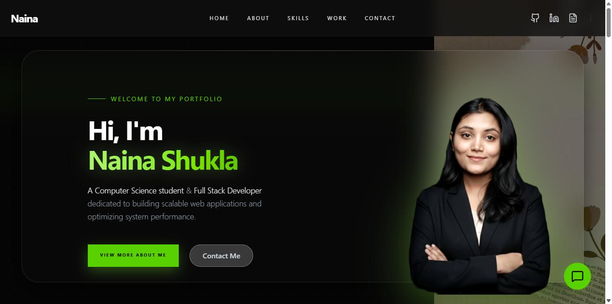
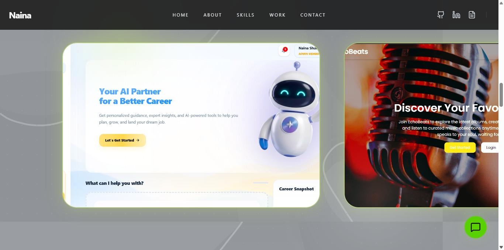

# AI Portfolio — chat with my résumé

My developer portfolio with a built-in AI assistant: instead of only reading a page, visitors and
recruiters can ask questions about my skills, projects and experience and get answers grounded in
my profile.

**Live:** https://ai-portfolio-6uo8.onrender.com
<sub>(free hosting — the first visit can take ~50 seconds to wake up)</sub>



## Features

- **AI profile assistant** — a chat widget backed by a FastAPI endpoint; the LLM
  (Llama 3.1 8B Instruct via OpenRouter) answers only from my profile and says so when something isn't covered
- **Sections:** hero, about, skills, work/projects and contact
- **Contact form** — sends email through EmailJS (to me, plus an auto-reply to the sender)
- **Responsive UI** with smooth animations (Framer Motion) and Lucide icons

## Architecture

```
React 19 + TypeScript (Vite, Tailwind, Framer Motion)
   ├─ ChatBot.tsx ──POST /chat──►  FastAPI (backend/main.py) ──►  OpenRouter · Llama 3.1 8B Instruct
   └─ Contact.tsx ──────────────►  EmailJS
```

## Tech stack

**Front end:** React 19 · TypeScript · Vite · Tailwind CSS · Framer Motion · Lucide · EmailJS
**Back end:** Python · FastAPI · OpenAI SDK (OpenRouter endpoint)
**Hosting:** Render

## Run locally

```bash
# back end
cd backend
pip install -r requirements.txt
# backend/.env:  OPENROUTER_API_KEY=...
uvicorn main:app --reload --port 8001

# front end (new terminal)
cd frontend
npm install
# frontend/.env:  VITE_API_URL=http://127.0.0.1:8001
#                 VITE_EMAILJS_SERVICE_ID / VITE_EMAILJS_ADMIN_TEMPLATE_ID / VITE_EMAILJS_PUBLIC_KEY ...
npm run dev        # http://localhost:5173
```

## Screens



## Author

**Naina Shukla** · [GitHub](https://github.com/Naina7120284) · [LinkedIn](https://www.linkedin.com/in/naina-shukla-15406a260/)
